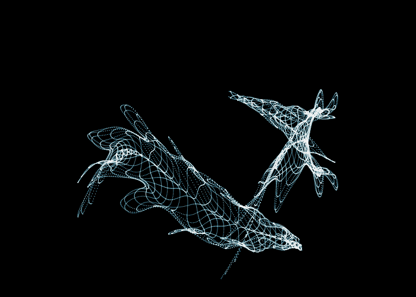

# Desktop Critters

Formula-driven animals that live on your Windows desktop. A creature is not a sprite
or a video — it's a **maths expression** evaluated over twenty thousand points every
frame, written in JSON that you can edit while the widget is running.



The fish above is a direct port of a p5.js point-cloud sketch. The whole creature is
this, and nothing else:

```jsonc
"vars": [
  { "name": "u",      "expr": "(i + 1) / n" },
  { "name": "y",      "expr": "u * spine" },
  { "name": "k",      "expr": "(4 + cos(y)) * cos(i)" },
  { "name": "e",      "expr": "y / 5 - 11" },
  { "name": "d",      "expr": "mag(k, e) - 5" },
  { "name": "c",      "expr": "d / 2.5 - t / 2 * bodyTurn + (i % 2) * 8" }
],
"px": "radius * cos(c)",
"py": "99 * sin(c / 3) + dd * sin(t * 2 - d) * sweep + ripple + flank * wobble"
```

---

## Quick start

Requires the .NET 8 SDK to build; the built exe needs only the .NET 8 runtime.

```bash
dotnet build src/DesktopCritters/DesktopCritters.csproj -c Release
```

```bash
./src/DesktopCritters/bin/Release/net8.0-windows/DesktopCritters.exe
```

A fish icon appears in the notification area. Right-click it for pause, layer, reload,
and exit. The widget is click-through, so the tray icon is the only thing you can
actually click.

On first run it writes its editable files to `%APPDATA%\DesktopCritters\`:

```
%APPDATA%\DesktopCritters\
├─ config.json            speed, colour, sandbox, layer, fps
└─ creatures\
   └─ fish.json           the body formula
```

Both are watched for changes — save the file and the desktop updates. No restart.

---

## How it works

### Two independent halves

A creature is split in two, and neither half knows about the other:

| | what it owns | where it lives |
|---|---|---|
| **Body formula** | the shape, in its own local space, centred on the animal | `creatures/*.json` |
| **Motion model** | where that animal is and which way it points | `config.json` → `motion` |

That split is the whole design. Swapping the swim path never touches the art, and
swapping the art never touches the swimming. The renderer composes them with a single
2×2 matrix per frame.

### Rendering

Creature formulas emit a *cloud of points*, so rather than rasterising shapes the
renderer accumulates a scalar **density field** — each point splats bilinearly into
four pixels — then maps density to premultiplied BGRA through a 1024-entry lookup
table. That buys three things at once: free anti-aliasing, free "brighter where the
points bunch up" shading, and a resolve pass that is one table read per pixel with no
floating-point maths at all.

The result goes to a **layered window** via `UpdateLayeredWindowIndirect`. There is no
Direct3D device to lose on a session switch, per-pixel alpha over the wallpaper is
free, and the widget owns the pixel memory directly, so the renderer writes straight
into the DIB with no intermediate copy.

### Staying visible when desktop icons are hidden

Explorer's desktop is a stack of windows: `Progman`, a `SHELLDLL_DefView` child that
hosts the icon list, and (usually) a `WorkerW` that paints the wallpaper behind it.

Turning off **Show desktop icons** hides `SHELLDLL_DefView` and *nothing else*. So a
widget parented to the icon view vanishes along with the icons — which is exactly the
failure this project set out to avoid. Desktop Critters therefore parents itself to
`WorkerW`, or to `Progman` when the shell has no separate `WorkerW` (common on current
Windows 11), and never to the icon view.

Verified on Windows 11 26200 with desktop icons *off*: the surface is a visible child
of `Progman`, sitting above the wallpaper, while `SysListView32` is hidden.

Three layers are available from the tray, or via `"layer"` in config:

- `desktop` — on the wallpaper, under your windows. The default.
- `bottom` — a free-floating window pinned to the bottom of the z-order.
- `topmost` — over everything. Good for demos and for checking the art.

---

## Configuration

`%APPDATA%\DesktopCritters\config.json`. Comments and trailing commas are allowed.

```jsonc
{
  "fps": 30,
  "layer": "desktop",             // desktop | bottom | topmost
  "pauseWhenFullscreen": true,    // idle while a fullscreen app covers the screen
  "watchConfig": true,

  "sandbox": {                    // the patch of desktop the creature stays inside
    "mode": "workArea",           // workArea | monitor | virtual | rect
    "monitor": "primary",         // primary | cursor | 0-based index
    "inset": 0,
    "x": 0, "y": 0, "width": 900, "height": 600   // used when mode is "rect"
  },

  "render": {
    "exposure": 1.8,              // how fast density saturates to opaque
    "densityRange": 3.0,          // density at which the ramp reaches its last colour
    "opacity": 0.95,
    "colors": ["#1b5f8a", "#3fb6e6", "#a9f0ff", "#ffffff"]   // sparse -> dense
  },

  "critters": [
    {
      "creature": "fish",         // creatures/fish.json
      "count": 1,
      "size": 300,                // body length in pixels
      "sizeVariance": 0.18,
      "bodySpeed": 1.0,           // multiplier on the body's animation cycle
      "seed": 1,                  // same seed = same swim, every time
      "params": { "bodyTurn": 0.25 },   // overrides for the creature's own params

      "motion": {
        "mode": "wander",         // wander | path | still
        "speed": 52,              // pixels per second
        "speedVariance": 0.35,    // burst-and-glide rather than robotic cruising
        "turnRate": 1.1,          // max radians per second
        "wanderFreq": 0.18,       // lower is lazier
        "wanderAmount": 0.9,
        "margin": 150,            // distance from an edge at which it turns away
        "avoidStrength": 2.4,
        "bank": 0.35,             // extra lean proportional to turn rate
        "bobAmount": 7, "bobFreq": 0.27
      }
    }
  ]
}
```

### Motion modes

**`wander`** (default) is steering-based: a slow noise field nudges the heading, the
sandbox edges push back, and the turn rate is capped so the creature banks through
corners instead of pivoting on the spot. This is the one that reads as *alive* —
a closed-form path eventually looks like a closed-form path, whereas bounded noise
never repeats.

**`path`** follows two formulas in sandbox-normalised coordinates, with `u` running
0→1 over `period` seconds. Heading comes from a finite difference of the curve, so the
body points along it without the formula having to say so:

```jsonc
"motion": {
  "mode": "path",
  "period": 34,
  "x": "0.5 + 0.38 * sin(TAU * u)",
  "y": "0.5 + 0.22 * sin(2 * TAU * u)"
}
```

**`still`** parks the creature mid-sandbox. Useful when tuning a body formula.

### A school of fish

```jsonc
"critters": [
  { "creature": "fish", "count": 6, "size": 190, "sizeVariance": 0.35, "seed": 7,
    "points": 9000,
    "motion": { "mode": "wander", "speed": 44, "wanderFreq": 0.22 } }
]
```

Individuals get their own size jitter, body-cycle phase offset, and wander seed, so
they don't beat in lockstep.

---

## Writing a creature

A creature file is a list of named intermediates plus two output expressions.

```jsonc
{
  "name": "fish",
  "points": 20000,
  "bodyRate": 2.356194490192345,   // radians of body phase per second
  "facing": 0,                     // degrees to rotate so +X is "forward"
  "params": { "wobble": 1.0 },     // named knobs, overridable from config.json

  "vars": [ { "name": "u", "expr": "(i + 1) / n" } ],

  "px": "...",       // local X, +X is forward
  "py": "...",       // local Y, +Y is down
  "weight": "1"      // per-point intensity
}
```

**Inputs available to every expression**

| name | meaning |
|---|---|
| `i` | point index, `0 … n-1` |
| `t` | body phase in radians, advancing at `bodyRate` |
| `n` | total point count |
| *params* | anything you declare in `params` |

Vars are evaluated in order and each is visible to the ones after it, and to `px`,
`py` and `weight`.

**The expression language** is deliberately close to JavaScript, so p5.js and Dwitter
sketches port with minimal editing:

- Operators `+ - * / %`, comparisons, `&&`, `||`, `!`, and `? :`.
  Comparisons yield `1.0` or `0.0`, so they compose with arithmetic: `(x > 0) * 5`.
- `%` is fmod with the sign of the dividend, same as JS.
- `^` is **exponentiation**, not bitwise xor, and binds tighter than unary minus, so
  `-2^2` is `-4`.
- Functions: `sin cos tan asin acos atan atan2 sinh cosh tanh sqrt cbrt abs exp log
  log2 log10 floor ceil round sign fract saturate sq min max pow clamp lerp mix step
  smoothstep wrap map select mag hypot dist noise snoise fbm`.
- Constants: `PI TAU TWO_PI HALF_PI QUARTER_PI E PHI`.

Anything unrecognised is a load-time error naming the creature, the field, and the
offset in the expression — the widget keeps running on the previous world rather than
dying.

### Free performance: keep time out of a var

Vars that never mention `t` are **hoisted automatically** — evaluated once per point at
load into a cache, and skipped entirely every frame after that. So pulling a
time-invariant sub-expression out into its own var costs nothing and removes it from
the hot loop permanently. The stock fish does this deliberately:

```jsonc
{ "name": "radius", "expr": "79 + k * k" },
{ "name": "ripple", "expr": "3 * sin(k * 2)" },
{ "name": "flank",  "expr": "sin(y / 9 + 6) * k * (e + sin(e * 4 - d * 4))" }
```

Only `c` mentions `t`, so only `c` and the two outputs run per frame. That removes
about two thirds of the trigonometry — measured at a **45% CPU reduction**, with
byte-for-byte identical output.

---

## Preview mode

Renders frames to PNG with no window, so you can iterate on a formula without
squinting at the desktop:

```bash
./src/DesktopCritters/bin/Release/net8.0-windows/DesktopCritters.exe --preview ./out --frames 12 --size 800x600
```

| flag | meaning |
|---|---|
| `--preview <dir>` | write frames here and exit |
| `--frames <n>` | how many frames (default 12) |
| `--size <WxH>` | canvas size (default 640x480) |
| `--fps <n>` | simulation step rate; large steps are sub-stepped correctly |
| `--motion <mode>` | override motion — defaults to `still` so you see the body |
| `--bg <hex\|none>` | composite over a colour, or keep alpha (default `111820`) |
| `--config <path>` | use a specific config |

`tools/montage.py` contact-sheets the output into a single image:

```bash
python tools/montage.py sheet.png out/frame000.png out/frame004.png out/frame008.png
```

---

## Performance

Measured on Windows 11, one fish, 20 000 points, 30 fps, single thread:

| sandbox | layer | CPU | working set |
|---|---|---|---|
| 700 × 500 | topmost | 7.3% of one core | 37 MB |
| 2560 × 1392 (full work area) | desktop | 7.3% of one core | 65 MB |

A full-screen sandbox costs the same CPU as a small one because presents use a dirty
rectangle — the blit scales with the fish, not the sandbox. Only memory grows, since
the density buffer and the DIB are both allocated at sandbox size (≈8 bytes/pixel
total). Shrink the sandbox if you care more about memory than roaming room.

Cheapest knobs, in order: lower `points`, lower `fps`, shrink `sandbox`.

Zero third-party dependencies — no WinForms, no WPF, no NuGet packages. Just Win32
P/Invoke and the BCL. The tray icon and the PNG encoder are both generated in code so
the repo carries no binary assets.

---

## Known limitations

- **One colour ramp for all critters.** The renderer accumulates every creature into a
  single density buffer, so per-critter palettes would need a second pass. Global
  `render.colors` only, for now.
- **The body formula rotates as it animates.** The original sketch's `-t/2` term turns
  the fish a full revolution per cycle, which fights being steered somewhere. The
  `bodyTurn` parameter damps this; `0.25` holds a heading while still looking alive,
  and `1.0` restores the original's endless circling.
- **`points` changes density, not length.** The original hard-coded `i/663` against
  exactly 20 000 points; dividing by `n` instead keeps the shape identical there while
  making the point count a quality dial.
- **Only one creature ships.** The fish. The engine is not fish-specific — adding an
  animal is a new JSON file in `creatures\` and a `"creature"` entry in config.

## Roadmap

- More animals: a bird, a manta, a jellyfish.
- Per-critter colour, via a second accumulation buffer.
- Creature-aware flocking, so a school reacts to its own members.
- Optional interaction with the mouse pointer.
